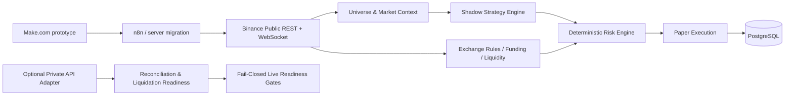

# Binance Futures Automation & Risk Engine

A server-native Binance Global USDⓈ-M Futures research, paper-trading, risk-management, and validation engine built as part of an AI automation / systems architecture portfolio.

The project started as a Make.com-based automation prototype and was progressively migrated to a self-hosted architecture using Python, FastAPI, PostgreSQL, Docker, and deterministic safety controls.

> **Current mode: PAPER ONLY.** Real order submission is intentionally blocked by hard safety guards.

## What this project demonstrates

- End-to-end automation architecture
- Migration from SaaS automation workflows to a self-hosted system
- Binance public REST/WebSocket integration
- Deterministic risk and position-sizing logic
- Multi-timeframe market analysis
- Paper execution and account simulation
- PostgreSQL event/journal persistence
- Dockerized deployment and service health checks
- Fail-closed safety design
- Automated test coverage

## Architecture



## Core capabilities

### Market layer

- Binance USDⓈ-M Futures public REST and WebSocket data
- Liquid USDT perpetual universe selection
- Exchange filters and symbol rules
- Mark-price monitoring
- Funding-rate awareness
- Order-book based dynamic slippage estimation

### Strategy & research

- 15m / 1h / 4h multi-timeframe analysis
- EMA trend regime detection
- Breakout + volume confirmation
- ATR-based stop construction
- Market-context scoring
- Shadow signal generation without automatic execution
- Historical backtest endpoint
- Shadow outcome tracking for later calibration

### Risk engine

- Stop-distance based position sizing
- Reward/risk validation
- Daily loss limit
- Hard drawdown limit
- Maximum concurrent positions
- Portfolio gross leverage limit
- Margin utilization limit
- Configurable leverage caps
- Exchange-rule normalization
- Liquidation-buffer readiness checks

### Paper execution

- Paper-only position lifecycle
- Fees and configurable slippage
- Funding application
- PnL and equity tracking
- Account snapshots
- Position close monitoring
- PostgreSQL event journal

### Safety & operations

- Hard `PAPER_ONLY` guard
- `LIVE_TRADING_ENABLED=false` requirement
- Scheduled no-new-trades window
- Fresh-market-data requirement
- Fail-closed live-readiness checks
- Optional private Binance adapter for reconciliation/readiness checks
- Docker health checks
- Read-only application filesystem
- Dropped Linux capabilities and `no-new-privileges`

## Stack

- Python 3.12
- FastAPI
- PostgreSQL 16
- Docker / Docker Compose
- Binance Global Futures APIs
- WebSockets
- Pytest

## Test status

Current server build validation:

```text
35 passed
```

The running Docker services were also verified healthy before publishing this portfolio snapshot.

## Repository structure

```text
app/                 Core application modules
scripts/             Backup and housekeeping utilities
tests/               Automated test suite
Dockerfile            Application container
docker-compose.yml    Engine + PostgreSQL services
.env.example          Safe configuration template
docs/                 Architecture and migration notes
```

## Quick start

1. Copy the environment template:

```bash
cp .env.example .env
```

2. Set a strong PostgreSQL password. Binance private API credentials are optional and should remain empty for public-data / paper-only use.

3. Start the stack:

```bash
docker compose up -d --build
```

4. Check health:

```bash
curl http://127.0.0.1:8091/health
```

## Security

Secrets, runtime state, logs, database volumes, and real account data are deliberately excluded from this repository. Never commit `.env`, API keys, tokens, credentials, or database dumps.

The published version is designed to demonstrate architecture and engineering work — not to provide financial advice or a production-ready live trading system.

## Project evolution

See `docs/make-to-server-migration.md` for the migration path from the original Make.com automation to the current self-hosted futures engine.

---

**Built by Emircan Dokumacı** as part of an AI Automation / Systems Architecture portfolio.
